# Flutterfly Travels

A travel planning web app for Bangladesh, built as the CSE 216 (Database) term project at BUET. Customers explore destinations, hotels, restaurants and flights, put them together into trips with a travel agent (or on their own), and chat with agents and other travellers. Agents plan the trips they are asked to, and admins approve new agents and trips that are ready to go.

Much of the app's logic lives in PostgreSQL: functions, a procedure and triggers keep costs, ratings, notifications and chat rules correct whatever the API is asked.

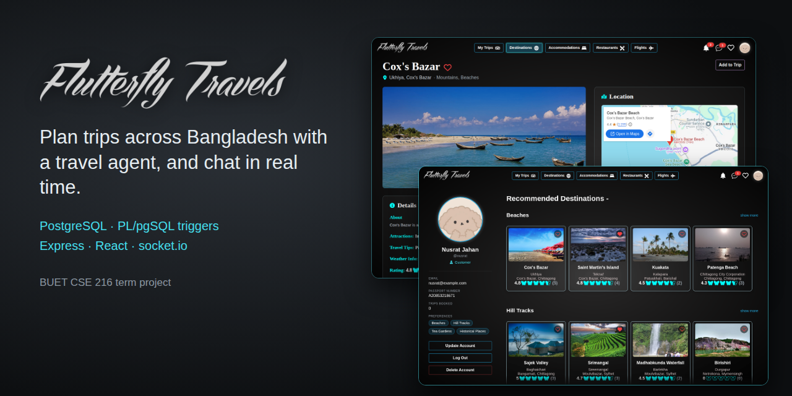

## Features

**Customers**
- Browse destinations, places to stay, restaurants and domestic flights, with filters for area, rating, type, facilities, price and time.
- Plan trips: add destinations, hotels, restaurants and flights. Only trips whose dates cover the booking are offered.
- Request an agent when creating a trip or later, or plan it alone and send it straight to an admin.
- Open an agent's profile to see their experience, fee, rating and reviews.
- Rate and review places, and the agents who have taken their trips, and keep a wishlist.
- Look through other customers' completed trips for ideas.

**Travel agents**
- Accept or decline requests, then build each trip with its customer.
- See their reviews, and get notified of every new rating or review.
- Approval by an admin before they can be chosen.

**Admins**
- Review new agent sign-ups and trips sent for approval.

**Everyone (except admins)**
- Chat in real time, with photos, a typing indicator, read receipts and unread counts. Agents can only message other agents and the customers they work with.
- Live notifications, for example "Sayeman Beach Resort was added to trip 'Cox's Bazar getaway'", shown as a pop-up and kept in the notification panel.

## Screenshots

*Taken with made-up demo accounts.*

| | |
|---|---|
| 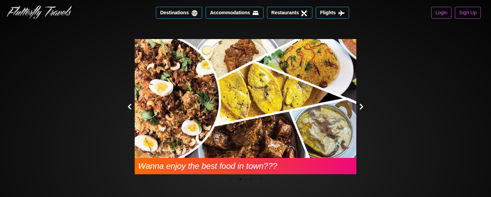 Home page | 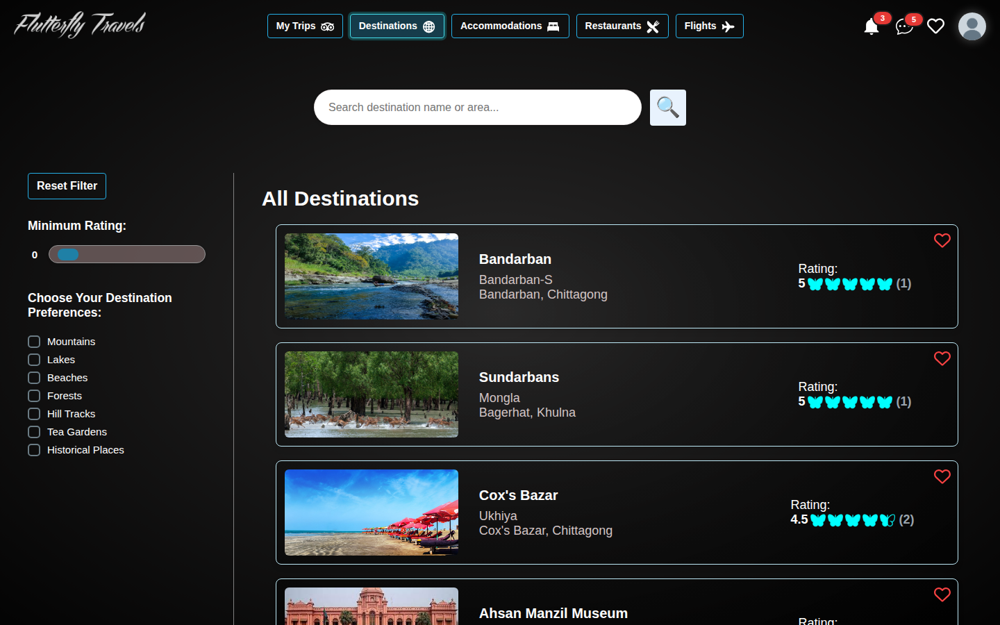 Destinations, with filters |
| 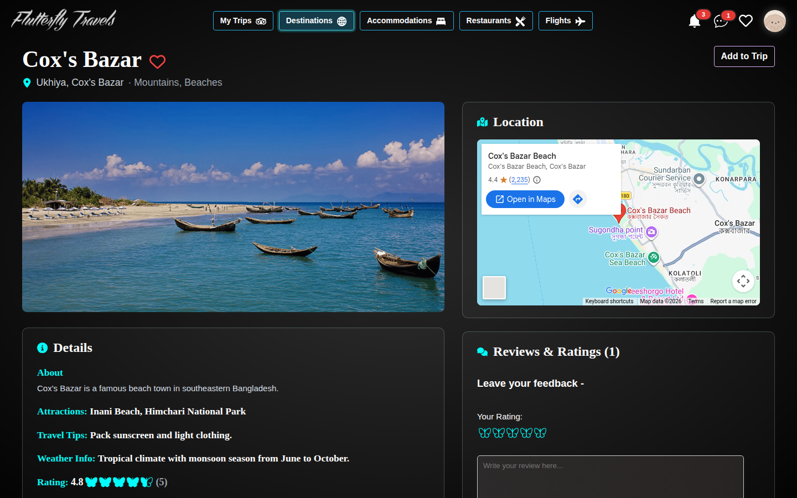 A destination's page | 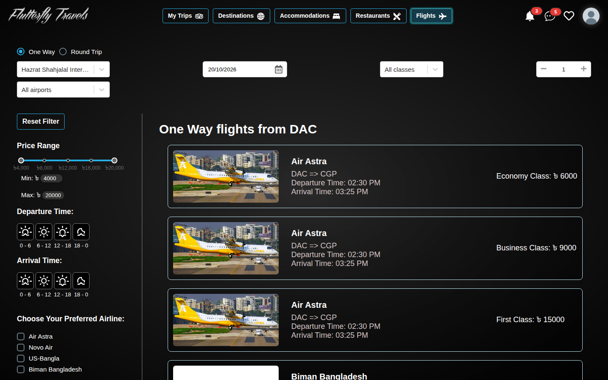 Flights |
| 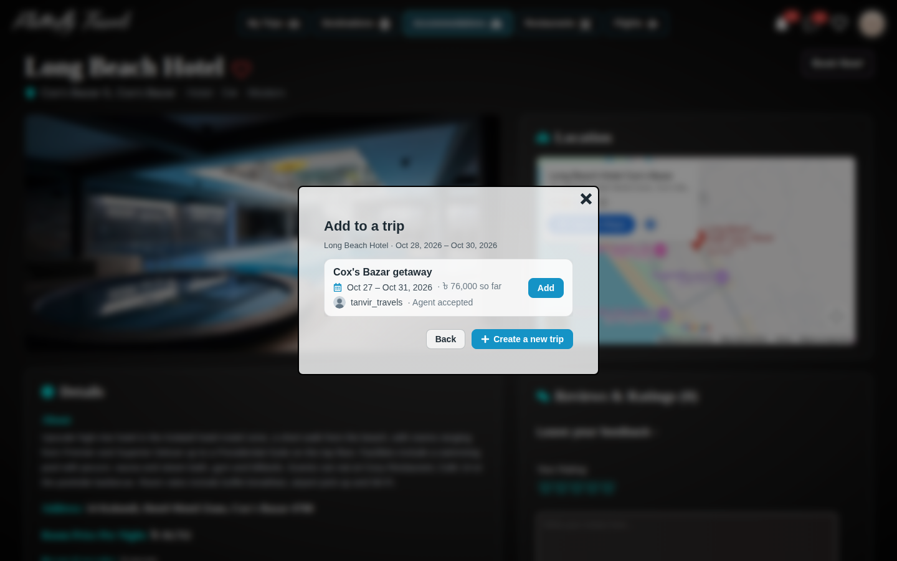 Adding a hotel to a trip | 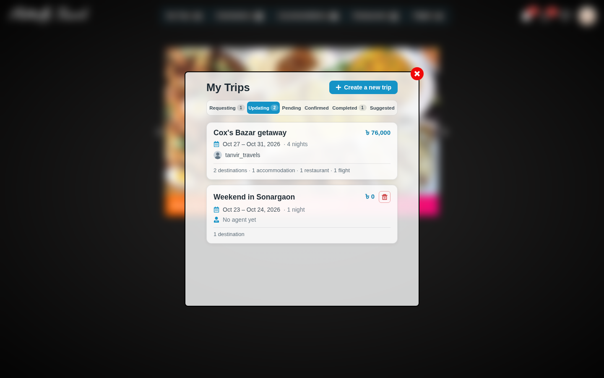 A customer's trips |
| 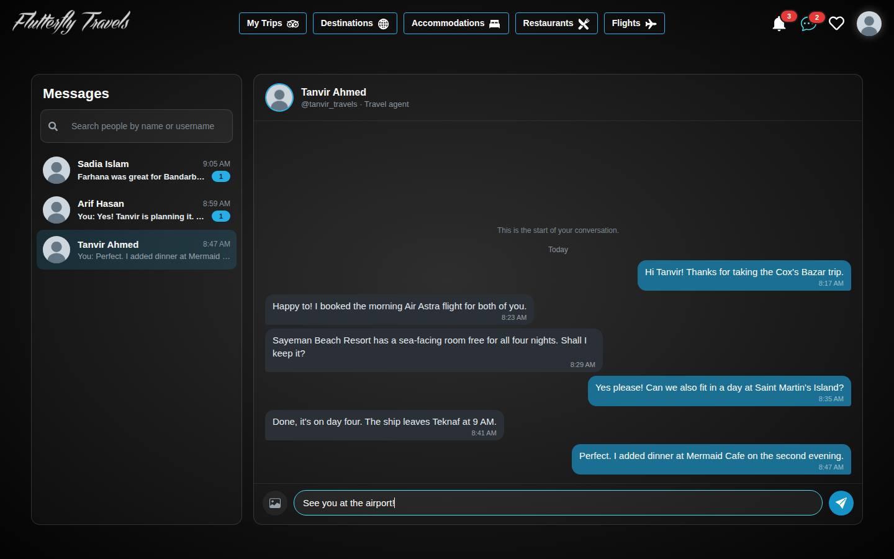 Chat between a customer and her agent | 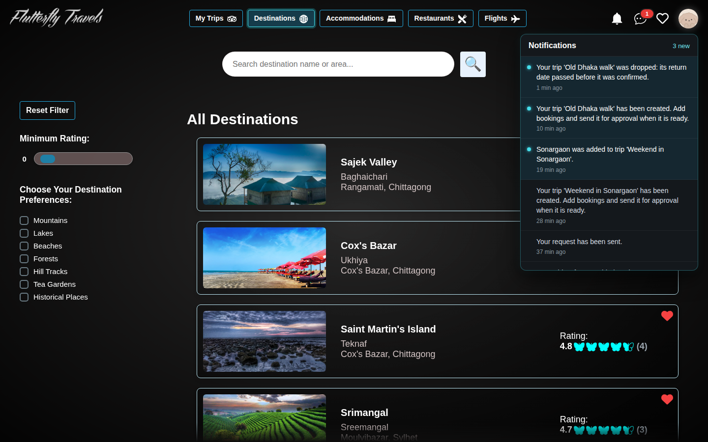 Notifications |
| 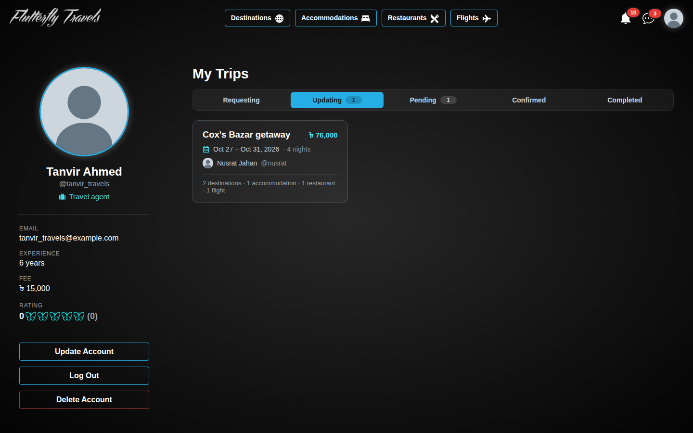 An agent's trips | 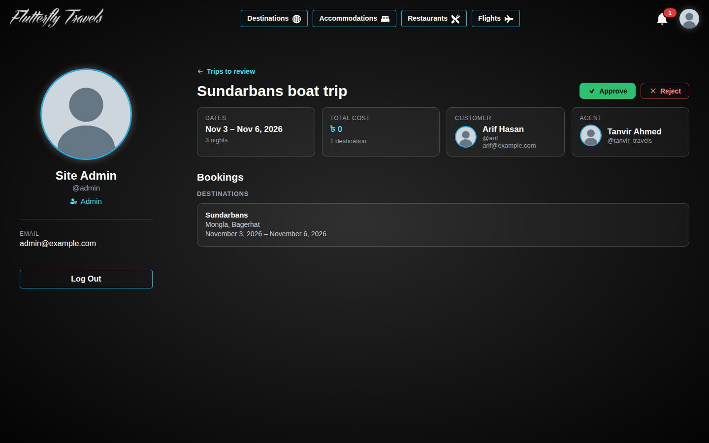 An admin reviewing a trip |

## Tech stack

| Part | Built with |
|---|---|
| Database | PostgreSQL 16+, with PL/pgSQL functions, a procedure, triggers and `LISTEN`/`NOTIFY` |
| Backend | Node.js, Express, `pg`, JSON Web Tokens, bcrypt, socket.io, multer |
| Frontend | React 18, Vite, React Router, socket.io-client |
| Images | Supabase Storage (public buckets) |

## Getting started

You need Node.js 20.19+ or 22.12+ (for Vite 7) and PostgreSQL 16 or newer. `schema.sql` was dumped by `pg_dump` 18, and its `\restrict` lines need a recent `psql`.

**1. Create the database**

```bash
sudo -u postgres createdb flutterfly_travels
sudo -u postgres psql -d flutterfly_travels < Backend/database/schema.sql
sudo -u postgres psql -d flutterfly_travels < Backend/database/seed.sql
```

The files are passed with `<`, so your own shell reads them. With `-f`, the `postgres` user would have to read them, and it usually can't open files in your home folder.

**2. Configure the backend**

```bash
cp Backend/.env.example Backend/.env
```

Then fill in `Backend/.env`:

- `DB_PASSWORD`: the password of the `postgres` role. If it has none yet, set one with `sudo -u postgres psql -c "\password postgres"`.
- `JWT_SECRET`: a long random string, for example from `node -e "console.log(require('crypto').randomBytes(48).toString('hex'))"`.
- `SUPABASE_URL`, `SUPABASE_SERVICE_ROLE_KEY` and `SUPABASE_BUCKET`: for the photos users upload (profile and chat photos), which go to your own Supabase Storage. Create a free project at [supabase.com](https://supabase.com), then under Storage create a bucket and mark it Public. Put its name in `SUPABASE_BUCKET`, and copy the project URL and the service role key from Project Settings > API. The service role key bypasses Supabase's access rules, so keep it in this file only. `Backend/.env` is git-ignored.

  Supabase is only needed for uploads. Without it, everything else works, but signing up or chatting with a photo fails.

Keep `PORT = 3000`: the frontend calls the API at `http://localhost:3000`.

**3. Run it**

In two terminals:

```bash
cd Backend && npm install && npm start      # API on http://localhost:3000
cd Frontend && npm install && npm run dev   # App on http://localhost:5000
```

On macOS, port 5000 may be taken by AirPlay Receiver. Turn it off in System Settings > General > AirDrop & Handoff, or change `server.port` in `Frontend/vite.config.js`.

**4. Create accounts**

The sample data has no accounts. Customers and agents sign up in the app; a new agent waits until an admin approves them. Admins can't sign up in the app. Create one from the command line:

```bash
cd Backend && npm run create-admin
```

The script asks for a username, email, name and password, and stores the password as a bcrypt hash.

## How it works

### The database does the bookkeeping

Triggers keep each trip's total cost, every item's average rating and each customer's count of completed trips up to date, and they write the notifications. A trip's status moves from `REQUESTING` or `UPDATING` through `PENDING` and `CONFIRMED` to `COMPLETED`, or to `DROPPED` if it was never confirmed before its return date.

The full design, with an entity-relationship diagram, the trip lifecycle and every function and trigger, is in **[docs/database.md](docs/database.md)**.

### Live notifications and chat

When a notification or a chat message is inserted, a trigger calls `pg_notify`. The backend listens on those channels and pushes the new row over socket.io to the people concerned, so nothing needs polling. Who may message whom is decided by the `can_message` function, and a trigger refuses any message it doesn't allow.

### Accounts and access

Logging in returns a JWT (valid for a day by default), which the app sends with every request. Browsing is public. Booking, trips, wishlists, reviews and chat need an account. A trip can be changed only by its customer, its agent or an admin, and only while it is being planned. Agent approval and trip confirmation are for admins only.

### Images

The home page photos ship with the frontend, in `Frontend/public/homepage/`. The places' photos are served from the authors' public Supabase Storage buckets (`destinations`, `accomodations`, `restaurants` and `flights`), and the sample data links to them from its `image*` columns, so they show up with no setup. Profile and chat photos that users upload go to the bucket set in `Backend/.env`, through the backend.

## Project structure

```
Backend/
  index.js            Express app (port from .env)
  auth.js             JWT checks: logged in, role, trip participant
  database.js         PostgreSQL connection pool (query, transaction)
  realtime.js         socket.io server: live notifications, chat messages and typing
  file_handling.js    Photo uploads to Supabase Storage
  create-admin.js     Creates an admin account (npm run create-admin)
  router/             API routes, one file per resource (user, customer, agent, destination,
                      accommodation, restaurant, flight, booking, trip, wishlist, chat)
  database/
    schema.sql        Tables, constraints, functions, procedure and triggers
    seed.sql          Places, flights and airports in Bangladesh (no accounts)
Frontend/
  src/Pages/          One component per page (destinations, flights, chat, profile, ...)
  src/Components/     Shared pieces (booking popups, trip views, date fields, ...)
  src/api.js          apiFetch: fetch that sends the login token
  src/chat.js         Chat events and the "who can I message" rule
docs/
  database.md         Database design
  screenshots/        The pictures in this README
ERD.pdf               The original conceptual ER diagram
IMAGE_CREDITS.md      Authors and licences of the Wikimedia Commons photos
```

## Credits

The photos of places and aircraft that come from Wikimedia Commons are listed, with their authors and licences, in [IMAGE_CREDITS.md](IMAGE_CREDITS.md).

## Authors

- Zaki Rehnoom Unmona ([@z-oh-9402](https://github.com/z-oh-9402))
- Mafruha Islam Aishi ([@usaben](https://github.com/usaben))

## License

The code is released under the [MIT License](LICENSE). Photos keep their own licences, listed in [IMAGE_CREDITS.md](IMAGE_CREDITS.md).
