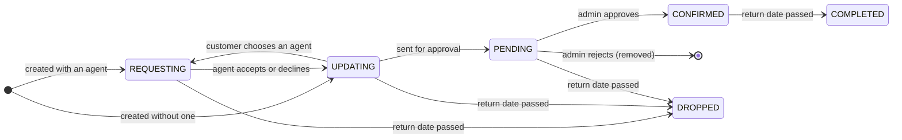

# Database design

Flutterfly Travels runs on PostgreSQL, and much of its behaviour lives in the database: 30 tables, 23 functions, 1 procedure and 20 triggers, all defined in [`Backend/database/schema.sql`](../Backend/database/schema.sql). The sample data is in [`Backend/database/seed.sql`](../Backend/database/seed.sql).

[`ERD.pdf`](../ERD.pdf) is the conceptual diagram the project started from. The diagram below is generated from the current schema, and shows every table with its keys and a few defining columns.

## Entity-relationship diagram

```mermaid
erDiagram
    LOCATION ||--o{ ACCOMMODATION : "location_id"
    BOOKING ||--o| ACCOMMODATION_BOOKING : "accommodation_booking_id"
    ACCOMMODATION ||--o{ ACCOMMODATION_BOOKING : "accommodation_id"
    ACCOMMODATION ||--o{ ACCOMMODATION_WISHLIST : "accommodation_id"
    CUSTOMER ||--o{ ACCOMMODATION_WISHLIST : "customer_id"
    USERS ||--o| AGENT : "agent_id"
    LOCATION ||--o{ AIRPORT : "location_id"
    TRIP ||--o{ BOOKING : "trip_id"
    USERS ||--o{ CONVERSATION : "user_a"
    USERS ||--o{ CONVERSATION : "user_b"
    USERS ||--o| CUSTOMER : "customer_id"
    CUSTOMER ||--o{ CUSTOMER_PREFERENCE : "customer_id"
    PLACE_TYPE ||--o{ CUSTOMER_PREFERENCE : "preference_id"
    LOCATION ||--o{ DESTINATION : "location_id"
    DESTINATION ||--o{ DESTINATION_TYPE : "destination_id"
    PLACE_TYPE ||--o{ DESTINATION_TYPE : "place_type_id"
    CUSTOMER ||--o{ DESTINATION_WISHLIST : "customer_id"
    DESTINATION ||--o{ DESTINATION_WISHLIST : "destination_id"
    DIVISION ||--o{ DISTRICT : "division_id"
    AIRPORT ||--o{ FLIGHT : "arrival_airport_id"
    AIRPORT ||--o{ FLIGHT : "departure_airport_id"
    BOOKING ||--o| FLIGHT_BOOKING : "flight_booking_id"
    FLIGHT ||--o{ FLIGHT_BOOKING : "flight_id"
    CUSTOMER ||--o{ GIFTS_AND_COUPONS : "customer_id"
    DISTRICT ||--o{ LOCATION : "district_id"
    CONVERSATION ||--o{ MESSAGE : "conversation_id"
    USERS ||--o{ MESSAGE : "sender_id"
    USERS ||--o{ NOTIFICATION : "user_id"
    CUSTOMER ||--o{ PAYMENT : "customer_id"
    TRIP ||--o{ PAYMENT : "trip_id"
    CUSTOMER ||--o{ RATING : "customer_id"
    LOCATION ||--o{ RESTAURANT : "location_id"
    BOOKING ||--o| RESTAURANT_BOOKING : "restaurant_booking_id"
    RESTAURANT ||--o{ RESTAURANT_BOOKING : "restaurant_id"
    CUSTOMER ||--o{ RESTAURANT_WISHLIST : "customer_id"
    RESTAURANT ||--o{ RESTAURANT_WISHLIST : "restaurant_id"
    CUSTOMER ||--o{ REVIEW : "customer_id"
    AGENT ||--o{ TRIP : "agent_id"
    CUSTOMER ||--o{ TRIP : "customer_id"
    DESTINATION ||--o{ TRIP_DESTINATION : "destination_id"
    TRIP ||--o{ TRIP_DESTINATION : "trip_id"
    ACCOMMODATION {
        int accommodation_id PK
        varchar name
        numeric rating
        int room_price
        int location_id FK
    }
    ACCOMMODATION_BOOKING {
        int accommodation_booking_id PK,FK
        int accommodation_id FK
    }
    ACCOMMODATION_WISHLIST {
        int wishlist_id PK
        int customer_id FK
        int accommodation_id FK
    }
    AGENT {
        int agent_id PK,FK
        int fee
        varchar acc_status
        numeric rating
    }
    AIRPORT {
        int airport_id PK
        int location_id FK
    }
    BOOKING {
        int booking_id PK
        int trip_id FK
        int cost
        varchar booking_type
    }
    CONVERSATION {
        int conversation_id PK
        int user_a FK
        int user_b FK
        int started_by
        timestamp last_message_at
    }
    CUSTOMER {
        int customer_id PK,FK
        int trip_booked
    }
    CUSTOMER_PREFERENCE {
        int customer_preference_id PK
        int customer_id FK
        int preference_id FK
    }
    DESTINATION {
        int destination_id PK
        varchar name
        numeric rating
        int location_id FK
    }
    DESTINATION_TYPE {
        int destination_type_id PK
        int destination_id FK
        int place_type_id FK
    }
    DESTINATION_WISHLIST {
        int wishlist_id PK
        int customer_id FK
        int destination_id FK
    }
    DISTRICT {
        int district_id PK
        varchar district_name
        int division_id FK
    }
    DIVISION {
        int division_id PK
        varchar division_name
    }
    FLIGHT {
        int flight_id PK
        varchar airline_name
        int departure_airport_id FK
        int arrival_airport_id FK
    }
    FLIGHT_BOOKING {
        int flight_booking_id PK,FK
        int flight_id FK
    }
    GIFTS_AND_COUPONS {
        int coupon_id PK
        int customer_id FK
        numeric discount
    }
    LOCATION {
        int location_id PK
        varchar location_name
        int district_id FK
    }
    MESSAGE {
        int message_id PK
        int conversation_id FK
        int sender_id FK
        varchar content
        varchar image
        timestamp seen_at
    }
    NOTIFICATION {
        int notification_id PK
        int user_id FK
        varchar content
        varchar notification_status
    }
    PAYMENT {
        int payment_id PK
        int customer_id FK
        int trip_id FK
        varchar payment_status
    }
    PLACE_TYPE {
        int place_type_id PK
        varchar type_name
    }
    RATING {
        int rating_id PK
        int customer_id FK
        varchar item_type
        int item_id
        int rating
    }
    RESTAURANT {
        int restaurant_id PK
        varchar name
        numeric rating
        int location_id FK
        int booking_cost
    }
    RESTAURANT_BOOKING {
        int restaurant_booking_id PK,FK
        int restaurant_id FK
    }
    RESTAURANT_WISHLIST {
        int wishlist_id PK
        int customer_id FK
        int restaurant_id FK
    }
    REVIEW {
        int review_id PK
        int customer_id FK
        varchar item_type
        int item_id
        varchar review
    }
    TRIP {
        int trip_id PK
        int agent_id FK
        int customer_id FK
        varchar name
        date departure_date
        date return_date
        int total_cost
        varchar trip_status
    }
    TRIP_DESTINATION {
        int trip_destination_id PK
        int trip_id FK
        int destination_id FK
    }
    USERS {
        int user_id PK
        varchar username
        varchar user_type
    }
```

## Tables

| Area | Tables |
|---|---|
| People | `users` (every account, with its `user_type`: customer, agent or admin), `customer` and `agent` (one row per customer or agent, sharing the user's id) |
| Places | `division` → `district` → `location`; `destination`, `accommodation`, `restaurant`; `place_type` and `destination_type` (a destination's categories, such as Beaches or Tea Gardens) |
| Flights | `airport`, `flight` |
| Trips | `trip`; `trip_destination` (destinations in a trip); `booking` with one subtype row in `accommodation_booking`, `restaurant_booking` or `flight_booking` |
| Customers | `customer_preference`, the three `*_wishlist` tables, `rating` and `review` (for destinations, hotels, restaurants, agents and trips, told apart by `item_type`), `gifts_and_coupons`, `payment` |
| Messages | `notification`; `conversation` and `message` (chat) |

### Constraints worth knowing

- **One rating per customer per item:** `UNIQUE (customer_id, item_type, item_id)` on `rating`.
- **Trip names:** unique per customer, `UNIQUE (customer_id, name)` on `trip`.
- **Trip status:** one of `REQUESTING`, `UPDATING`, `PENDING`, `CONFIRMED`, `COMPLETED` and `DROPPED`, checked on `trip`.
- **Chat:** each pair of people has at most one `conversation`, stored smaller id first (`CHECK (user_a < user_b)`, `UNIQUE (user_a, user_b)`). A `message` must have text or a photo.
- **Contact details:** emails must look like `x@y.z`, and phone numbers must be 11 digits.

## Trip lifecycle

1. A trip created **with an agent** waits in `REQUESTING` until the agent accepts it (`UPDATING`) or declines it (back to `UPDATING` without an agent).
2. A trip created **without an agent** starts in `UPDATING`. The customer adds bookings, and either chooses an agent later (back to `REQUESTING`) or sends the trip straight to an admin.
3. While a trip is `REQUESTING` or `UPDATING` its customer can change its bookings, and its agent can too once they've accepted it.
4. Sending it for approval makes it `PENDING`. An admin confirms it (`CONFIRMED`) or rejects it, which removes it.
5. The day after its return date, a `CONFIRMED` trip becomes `COMPLETED`. Any trip that never got confirmed becomes `DROPPED`.

## Functions and procedure

| Name | What it does |
|---|---|
| `check_username(name)` | 1 if the username is taken, -1 if it is free (used during sign-up). |
| `check_trip_name(name, customer)` | Whether the customer already has a trip with that name. |
| `get_booking_id(trip, type, cost)` | Inserts a `booking` row and returns its id, for the subtype row that follows. |
| `refresh_item_rating(type, id)` | Recomputes an item's average rating (to one decimal) and its number of ratings. |
| `can_message(sender, receiver)` | The chat rule: customers can write to anyone; approved agents to other agents, to customers they share an unfinished trip with, and in conversations a customer started; admins take no part. |
| `get_conversation_id(starter, other)` | The two people's conversation, created on the first message if `can_message` allows it. |
| `fetch_filtered_flights(from, to, class, style, OUT cursor)` *(procedure)* | Returns a cursor of flights between two airports for a seat class and one-way or round trip. A NULL airport or class means any. |

The other 16 functions are trigger functions, listed below.

## Triggers

| Table | Trigger | What it does |
|---|---|---|
| `booking` | `update_total_cost` | Adds the booking's cost to its trip's total (the API takes it off again when a booking is removed). |
| `rating` | `update_item_rating` | Keeps the rated item's `rating` and `rating_count` in step with its ratings (`refresh_item_rating`). |
| `destination`, `accommodation`, `restaurant`, `flight`, `trip` | `*_delete_trigger` | Deletes the ratings and reviews of an item that is deleted. |
| `trip` | `add_trip_count_and_discount` | Counts a customer's completed trips, and records a coupon in `gifts_and_coupons` for each of the first 45, with a discount that grows by 2% every third trip. The app doesn't show or apply coupons yet. |
| `trip` | `notification_add_for_trip` | Notifies the customer, the agent and the admins as a trip is created, accepted, declined, sent for approval, approved, completed, dropped or removed. |
| `trip_destination`, `accommodation_booking`, `restaurant_booking`, `flight_booking` | `notification_add_for_*` | Tells the customer ("Sayeman Beach Resort was added to trip 'Cox's Bazar getaway'") and the agent ("… of customer nusrat") what was added to a trip. |
| `*_wishlist` | `update_*_wishlist` | Confirms additions to and removals from the customer's wishlist. |
| `agent` | `notify_agent_signup` | Tells every admin about a new agent sign-up, and the agent when they are approved or declined. |
| `message` | `check_message_allowed` | Refuses a message its sender may not send (`can_message`), whatever the API was asked. |
| `message` | `message_created` | Moves the conversation to the top of both people's lists, and announces the message with `pg_notify`. |
| `notification` | `notification_created` | Announces every new notification with `pg_notify`. |

## Live updates

The last two triggers make notifications and chat messages appear immediately, without polling:

1. The trigger calls `pg_notify('notification_created', id)` or `pg_notify('message_created', id)`. PostgreSQL delivers it only when the inserting transaction commits.
2. The backend ([`Backend/realtime.js`](../Backend/realtime.js)) keeps one connection running `LISTEN` on both channels. For each one it reads the row and sends it over socket.io to the open tabs of the people concerned.
3. Socket connections log in with the same JWT as the API, so everyone receives only their own notifications and messages.
